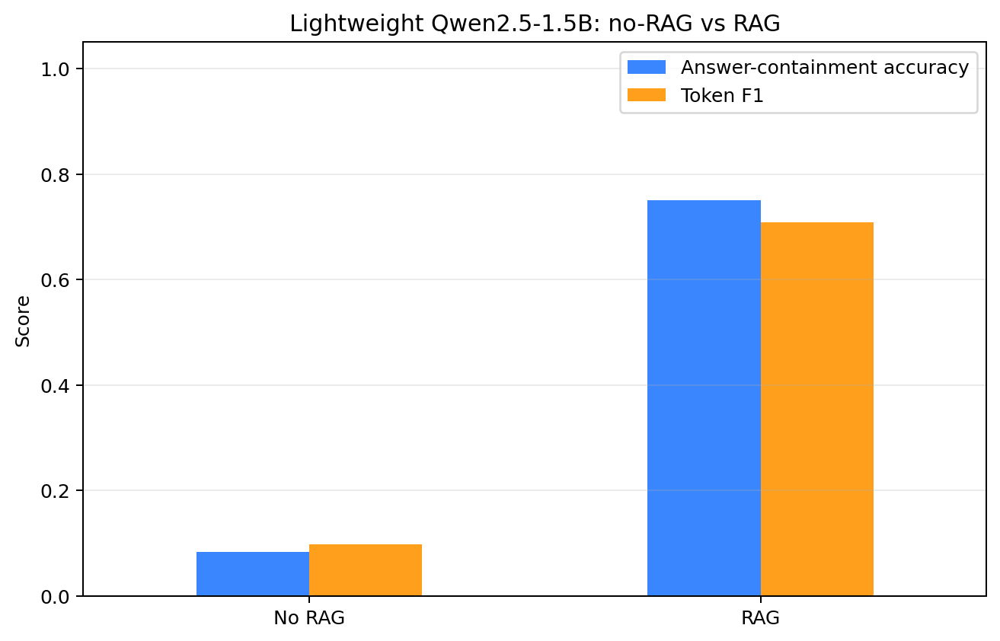

# Local research assistant

**Can a small model answer questions about research papers without making things up?** With retrieval, much better. On 12 test questions, a 1.5B model running on a laptop went from 8% to 75% of answers containing the reference fact, each citing the PDF page it came from.



*RAG · Ollama · Qwen2.5 · FAISS · Streamlit* · [Persian write-up](README_FA.md) · [Saved demo outputs](outputs/demo_outputs.md)

## What I did

- Indexed four retrieval papers (REALM, DPR, RAG, FiD): section-aware PDF extraction with PyMuPDF, then 488 chunks of 80 words with 15 words of overlap.
- Embedded the chunks locally (`all-minilm`, 384 dimensions) into FAISS and retrieved the top three by cosine similarity.
- Answered with Qwen2.5 1.5B through Ollama, citing PDF pages. Questions outside the papers fall back to a clearly labelled general answer, past a calibrated similarity threshold.
- Routed requests to six research tools (compare results, write a mini survey, list research gaps, compare reference years and more), with a keyword fallback when the model's tool call is invalid.
- Built a command line and a Streamlit interface.


## What I found

| Measure | Result |
| --- | ---: |
| Right paper ranked first | 85% |
| Right paper in the top three | 100% |
| In-scope or out-of-scope, held-out questions | 15 of 15 |
| Tool routing, 12 requests | 12 of 12 (one by keyword fallback) |
| Answers containing the reference fact, without and with retrieval | 8% → 75% |
| Token F1, without and with retrieval | 0.10 → 0.71 |

- **Retrieval does the heavy lifting.** The model is the same in both rows; only the context changes.
- **Small models need a safety net.** One of 12 tool calls came back malformed, and the keyword fallback caught it.
- These are small, hand-made test sets for a four-paper corpus. Containment and token F1 measure overlap with reference answers, not whether every sentence is supported by its citation.

## Try it

Uses Windows PowerShell, Python 3.11 and [Ollama](https://ollama.com); everything runs locally.

1. Save the four papers in `Researchs/` under the names in the [paper setup guide](Researchs/README.md).
2. Start Ollama and run `.\setup.ps1`. It creates `.venv`, installs the dependencies, pulls `qwen2.5:1.5b` and `all-minilm`, and builds the index.
3. Ask away:

```powershell
.\run_demo.ps1                                      # interactive command line
.\.venv\Scripts\python.exe cli.py -q "How does Fusion-in-Decoder combine evidence from multiple passages?"
.\.venv\Scripts\python.exe -m streamlit run app.py  # web interface
```

To rerun the evaluation: `scripts\build_index.py`, then `scripts\run_evaluation.py`.

## Layout

| Path | What's there |
| --- | --- |
| [`src/research_assistant/`](src/research_assistant/) | Retrieval, model client and research tools |
| [`app.py`](app.py) · [`cli.py`](cli.py) | Streamlit and command-line interfaces |
| [`data/`](data/) | Curated paper facts and evaluation questions |
| [`outputs/`](outputs/) | Figures, evaluation results and example outputs |

Data mining course project, University of Isfahan, 2026.
