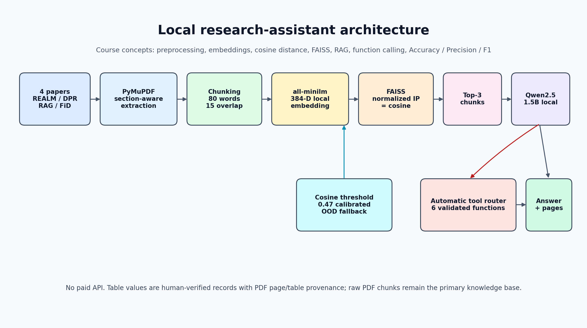

# Local Research Assistant

A local RAG application for exploring four research papers: REALM, DPR, RAG and FiD. Ask questions, retrieve supporting passages with PDF page references, and use research tools to compare the papers.

Built with **Python, Ollama, Qwen2.5, FAISS and Streamlit** as a university data mining project.

[توضیحات فارسی](README_FA.md) · [Saved demo outputs](outputs/demo_outputs.md) · [Paper setup](Researchs/README.md)



## Features

- Extract PDF text by page and section, then divide it into overlapping chunks.
- Generate local embeddings with `all-minilm` and retrieve passages using FAISS cosine similarity.
- Answer questions with `qwen2.5:1.5b` and references to retrieved PDF pages.
- Route requests to six research tools, with a keyword fallback when the model does not return a valid tool call.
- Offer a separately labelled general-model response when relevant evidence is unavailable.
- Provide both a command-line interface and a Streamlit interface.

The research tools compare results, produce a short survey, list research gaps and limitations, and compare reference years. Several tools use the curated records in [`data/paper_facts.json`](data/paper_facts.json). The PDF retrieval pipeline also includes eight curated result/method records to preserve information from tables and key passages.

## Quick start

The existing setup workflow uses **Windows PowerShell, Python 3.11 and Ollama**. Model inference runs locally. Initial setup downloads Python dependencies and the two Ollama models.

### 1. Add the papers

Download the four papers and save them in `Researchs/` using the filenames in the [paper setup guide](Researchs/README.md). The setup script expects these PDFs to be present before it builds the index.

### 2. Set up the environment

Start Ollama, open PowerShell in this project directory, and run:

```powershell
.\setup.ps1
```

This creates `.venv`, installs the pinned dependencies, downloads `qwen2.5:1.5b` and `all-minilm`, builds the FAISS index, and generates the demo figures.

### 3. Open the assistant

Interactive command line:

```powershell
.\run_demo.ps1
```

Ask a single question:

```powershell
.\.venv\Scripts\python.exe cli.py -q "How does Fusion-in-Decoder combine evidence from multiple passages?"
```

Open the Streamlit interface:

```powershell
.\.venv\Scripts\python.exe -m streamlit run app.py
```

## Example requests

```text
How does Fusion-in-Decoder combine evidence from multiple passages?
Compare the results of all papers and draw a chart.
Generate a mini survey of the selected papers.
Find research gaps and future work.
Compare references by publication year.
```

The [saved demo outputs](outputs/demo_outputs.md) show examples of the research tools without requiring local model setup.

## Saved project results

The following values come from the existing project run in [`outputs/evaluation_summary.json`](outputs/evaluation_summary.json).

| Measure | Recorded result |
| --- | ---: |
| Top-1 paper retrieval accuracy | 85.00% |
| Retrieval Hit@3 | 100.00% |
| Retrieval F1@3 | 85.12% |
| Tool-routing accuracy, 12 requests | 100.00% |

For the 12-question answer comparison:

| Measure | Without RAG | With RAG |
| --- | ---: | ---: |
| Answer containment | 8.33% | 75.00% |
| Mean token F1 | 9.72% | 70.83% |

The routing result includes 11 model tool calls and one keyword fallback. These are small, manually assembled evaluation sets for this four-paper corpus. Answer containment and token F1 describe answer matching; they do not establish that every generated statement is supported by its citation.

## Design choices

- **Local models:** Qwen2.5 1.5B and 384-dimensional `all-minilm` embeddings.
- **Retrieval:** 80-word chunks, 15-word overlap, three retrieved passages and a configured relevance threshold of 0.47.
- **Traceability:** page and section metadata accompany chunks; important table and method records also carry source references.
- **Research comparisons:** paper benchmark values are reported results from their authors. Their model sizes and retrieval budgets differ.

The corpus is configured for these four papers. The structured tools and curated facts are specific to this collection. Reference-year extraction uses a heuristic, and PDF tables and multi-column layouts can require special handling.

## Project structure

```text
app.py                        Streamlit interface
cli.py                        Command-line interface
src/research_assistant/        Retrieval, model client and research tools
data/                         Curated paper facts and evaluation questions
Researchs/                    Paper setup guide and local PDFs
scripts/                      Index building and evaluation scripts
tests/                        Existing project tests
outputs/                      Selected figures, results and example outputs
```

## Existing evaluation commands

With the environment and papers set up:

```powershell
.\.venv\Scripts\python.exe scripts\build_index.py
.\.venv\Scripts\python.exe scripts\run_evaluation.py
.\.venv\Scripts\python.exe -m pytest -q
```

The original implementation, Persian write-up and recorded results are retained alongside this portfolio introduction.
